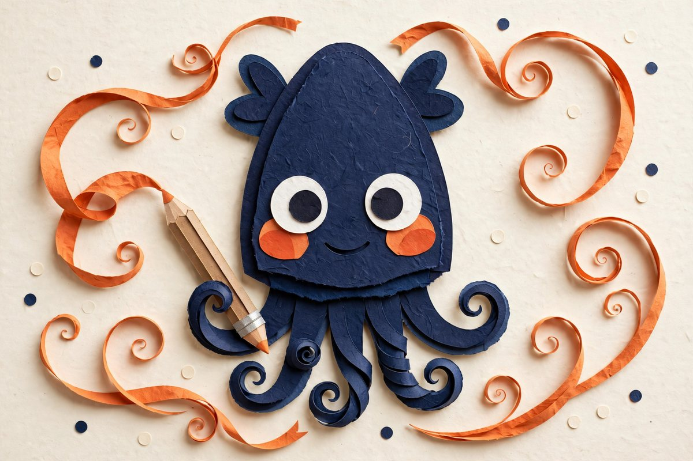

# Tinta

**Track:** AI + Health · **Team:** solo · **Starting point:** my own idea

**[Try it in your browser](https://ruby570bocadito.github.io/Tinta-Veritas-AI-Hackaton/)** (best on a phone; English and Spanish) · Video: <!-- TODO: link -->

> This project is a prototype and is not medical advice.

## The problem

Lucía is 45. Her mother Carmen, 72, repeats questions and left the stove on last week. Is it normal forgetfulness, or should they see a doctor? People with Alzheimer's hesitate more while writing: the pen spends longer in the air between strokes. Paper hides that. A touchscreen can time it.

## What I built

A web app (also an offline Android app) where Carmen does two practice tasks and three scored ones with her finger: trace a circle, write "le" four times, copy a word backwards. After each task Tinta replays her "invisible ink": where the finger left the screen and for how long. She gets one of three answers: **within the usual pattern**, **worth mentioning to a doctor**, or **I can't tell**. If the short check is unsure, three more tasks follow and three models vote. Everything runs on the phone; nothing is sent anywhere.

## What I added

The public study needs 25 tasks on a professional tablet. I (1) cut it to tasks that work with a finger on a phone, (2) kept only measures that do not depend on how fast the person or the device is, (3) tested what breaks that idea, and (4) built the app, with real cases it gets wrong.

## How it works

**Data.** [DARWIN](https://doi.org/10.24432/C55D0K): 174 people (89 diagnosed with Alzheimer's, 85 healthy), 25 handwriting tasks, pen on paper over a tablet. No missing values.

**Model.** Logistic regression on two numbers per task: the share of the task spent with the pen in the air, and the number of pen-downs. Tasks are chosen by forward selection on training people only. When the score lands between 35 and 65 (a band I set by hand, not tuned), three more tasks are asked and a logistic regression, an RBF SVM and a random forest are averaged. All of it runs in the browser; `npm run check:model` confirms the app matches scikit-learn to four decimals.

## Results

Nested cross-validation (5 folds, repeated 3 or 4 times; tasks and settings re-chosen inside every fold).

| On the study's tablet | Accuracy | Patients caught | Healthy wrongly flagged |
|---|---|---|---|
| **Baseline: stopwatch rule**, 3 tasks | 80% | 78% | 19% |
| Tinta, short check (3 tasks) | 75% | 69% | 18% |
| Tinta, adaptive (4.0 tasks on average) | 77% | 74% | 19% |

**My model does not beat a stopwatch.** With few tasks nothing I tried did; a trained model only wins with all 25 tasks (91% against 81%). On 35 people held out from training, Tinta missed 4 of 18 patients and wrongly flagged 2 of 17; the stopwatch missed 3 and flagged 3. Those 35 were not untouched: I looked at them while choosing the design.

**What Tinta has instead.** A stopwatch threshold is in milliseconds. If a device makes everyone 1.5 times slower, it flags 64% of healthy people. Tinta's two measures are a share and a count, so overall speed cancels out. That is arithmetic, not a finding.

**Where it fails, and why** (`ml/results/8_ablation.txt`).

- *A device that changes pauses and strokes differently.* If pauses doubled, half of healthy people would be flagged. If strokes took twice as long, more than half of patients would be missed. I do not know which a finger on glass does.
- *Slow writers.* 35% of the slowest healthy third are flagged, against 15 to 18% of the rest. The data has no age or sex, so writing speed is the only group I could check.
- *My first idea was wrong.* I planned to measure each task against the person's own warm-up pace. On its own that scores 59%, barely above chance, so I removed it.
- *Diagnosed patients, half the sample.* In real life far fewer people have the disease, so most "worth mentioning" results would be false alarms. This is not an early-detection test.
- *Never tested with patients on a phone.* The study was in Italian, with a pen.

## What I'd do next

Record healthy volunteers, and then people with a diagnosis through a patients' association, on real phones. That would replace the simulated device changes with measured ones. `ml/own_data.py` and the app's study mode (`?study`) are ready for it.

## Sources

- **Dataset:** Fontanella, F. (2022). DARWIN. UCI Machine Learning Repository, CC BY 4.0, https://doi.org/10.24432/C55D0K. Cilia et al. (2022), *Diagnosing Alzheimer's disease from on-line handwriting*, Engineering Applications of AI. Task list from https://arxiv.org/abs/2405.00755.
- **Libraries:** scikit-learn, pandas, NumPy, matplotlib; React, Vite, TypeScript; AndroidX WebKit. Fonts via Fontsource (SIL OFL).
- **Images:** the pictures of Tinta were generated with Meta's Muse Image model from my own prompts.
- **Health facts in "Ask Tinta":** WHO dementia fact sheet; US National Institute on Aging.
- **AI tools:** Claude Code (Anthropic) helped plan, write and debug the code and draft this text. I ran and checked every experiment and can explain each part.

How to run everything: [`ml/README.md`](ml/README.md). MIT License.
