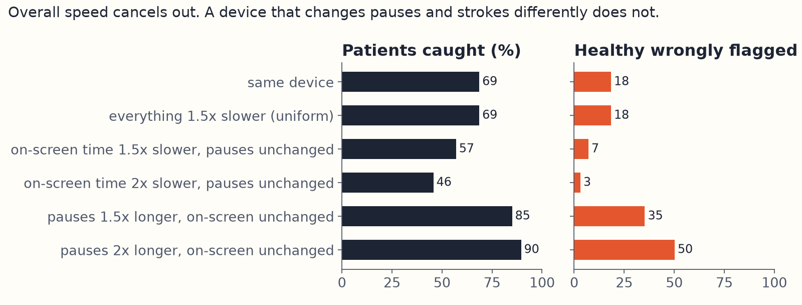

# Tinta

**Track:** AI + Health · **Team:** solo · **Starting point:** my own idea

**[Try it in your browser](https://ruby570bocadito.github.io/Tinta-Veritas-AI-Hackaton/)** (best on a phone; English and Spanish) · Video: <!-- TODO: link -->

> This project is a prototype and is not medical advice.

## The problem

Carmen, 72, repeats questions and left the stove on last week. Is it normal forgetfulness, or should her family see a doctor? People with Alzheimer's hesitate more while writing: the pen spends longer in the air. Paper hides that. A touchscreen can time it.

## What I built

A web app (also an offline Android app). Carmen does two practice tasks and three scored ones with her finger. Tinta replays her "invisible ink" (where the finger left the screen, and for how long) and answers **usual pattern**, **worth mentioning to a doctor** or **I can't tell**. If the short check is unsure, three more tasks follow and three models vote. If a task was not really done, she says what she saw and gives **no result**. Nothing leaves the phone.

## What I added

The public study needs 25 tasks on a professional tablet. I cut it to tasks that work with a finger, kept only measures that ignore overall speed, tested what breaks that idea, recorded eight people on real phones, had testers attack the app, and made it show real cases it gets wrong.

## How it works

**Data.** [DARWIN](https://doi.org/10.24432/C55D0K): 174 people (89 diagnosed with Alzheimer's, 85 healthy), 25 handwriting tasks, pen on paper over a tablet.

**Model.** Logistic regression on two numbers per task: the share of the task spent with the pen in the air, and the number of pen-downs. A score between 35 and 65 (a band I set by hand) triggers the closer look: three more tasks and the average of a logistic regression, an RBF SVM and a random forest. Everything runs in the browser; `npm test` checks it against scikit-learn.

## Results

Nested 5-fold cross-validation, repeated 3 or 4 times.

| On the study's tablet | Accuracy | Patients caught | Healthy flagged |
|---|---|---|---|
| **Baseline: stopwatch rule**, 3 tasks | 80 to 82% | 78% | 19% |
| Baseline: air share alone, 3 tasks | 75% | 75% | 25% |
| Tinta, short check | 74 to 75% | 69% | 18% |
| Tinta, adaptive (4.0 tasks on average) | 77% | 74% | 19% |

**My model does not beat a stopwatch**, and counting pen-downs adds nothing measurable over air share alone. A trained model only wins with all 25 tasks (91% against 81%).

**What people would actually be told** by the adaptive check:

| | Usual pattern | I can't tell | Worth mentioning |
|---|---|---|---|
| Of 100 patients | 19 | 15 | 65 |
| Of 100 healthy people | 74 | 13 | 14 |

**Where it fails** (`ml/results/8_ablation.txt`).

- *A different device* (simulated). 1.5 times slower: a stopwatch flags 64% of healthy people, while a share and a count do not change, by arithmetic. But pauses twice as long: half of healthy people flagged. Strokes twice as long: more than half of patients missed.
- *On real phones: my own data* (`ml/results/10_own_data.txt`). Eight healthy volunteers, one of them me: none was told "worth mentioning". But a tablet sees the pen hovering and a phone cannot see a finger in the air. In the study nobody had zero time in the air; on a phone a word written in one drag has exactly that, a value the model never saw. Three of my eight did it and got "usual pattern" with the lowest possible score. The app now gives no result then, and asks for the word letter by letter. Phone scores run low, and **no patient has tried it on a phone.**
- *Done wrong on purpose* (`ml/results/11_done_wrong.txt`). A tester scribbled through the tasks and was told "usual pattern": the model reads pauses, not whether the task was done. Now plain geometry checks each task first, 26 made-up people run through the app's logic in `npm test`, and nine role-playing testers (language models) tried to fool it. Still open: Tinta cannot read, so a long scribble with a few lifts gets a score, and very slow writing with the finger down looks "usual": ignoring speed also ignores slowness.
- *Slow writers.* 35% of slow healthy test cases were flagged (9 of 26), against 15 to 18% of the rest. The data has no age or sex to check.
- *My first idea was wrong.* Each task against the person's own warm-up pace scores 59% alone. Removed.
- *Not early detection.* Patients were already diagnosed and are half the sample; in real life most "worth mentioning" results would be false alarms.

## What I'd do next

Record people with a diagnosis on real phones, through a patients' association, and relearn the thresholds from finger data. Time the stops of a finger resting on the glass, the phone's version of a hovering pen (study mode, `?study`, already saves them).

## Sources

- **Dataset:** Fontanella, F. (2022). DARWIN. UCI Machine Learning Repository, CC BY 4.0, https://doi.org/10.24432/C55D0K (Cilia et al. 2022; task list: https://arxiv.org/abs/2405.00755).
- **Code:** scikit-learn, pandas, NumPy, matplotlib; React, Vite, TypeScript, Fontsource; AndroidX WebKit.
- **Images:** generated with Meta's Muse Image model from my prompts. **Health facts:** WHO; US National Institute on Aging.
- **AI tools:** Claude Code (Anthropic) helped plan, write and debug the code, draft this text, review the project and play nine kinds of user to test it. I ran and checked every experiment and can explain each part.

How to run everything: [`ml/README.md`](ml/README.md). MIT License.
