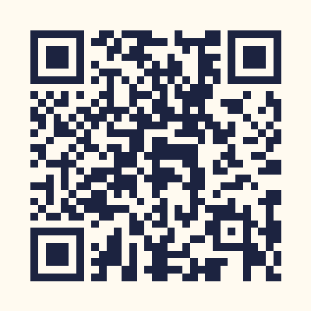
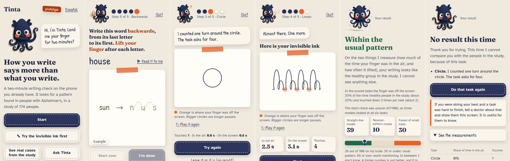

# Tinta

**Track:** AI + Health · **Team:** solo · **Starting point:** my own idea

**[Try it in your browser](https://ruby570bocadito.github.io/Tinta-Veritas-AI-Hackaton/)** (best on a phone: scan the code; English and Spanish; works offline after the first visit)

> This project is a prototype and is not medical advice.

## The problem

Carmen, 72, repeats questions and left the stove on last week. Is it normal forgetfulness, or should her family see a doctor? People with Alzheimer's hesitate more while writing: the pen spends longer in the air. Paper hides that. A touchscreen can time it.

## What I built

A web app (also for Android). Carmen does two practice tasks and three scored ones with her finger; before each one, Tinta draws an example on the sheet. Then Tinta replays her "invisible ink" (where the finger left the screen, and for how long) and answers **usual pattern**, **worth mentioning to a doctor** or **I can't tell**. If unsure, three more short tasks follow and three models vote. If a task was not really done, she says what she saw and gives **no result**. Nothing leaves the phone.

## What I added

The study needs 25 tasks on a professional tablet. I cut it to tasks that work with a finger, kept only measures that ignore speed, tested what breaks that, recorded 15 people on real phones, had testers attack the app, and dropped my first idea (pace against one's own warm-up: 59% alone).

## How it works

**Data.** [DARWIN](https://doi.org/10.24432/C55D0K): 174 people (89 diagnosed with Alzheimer's, 85 healthy), 25 handwriting tasks, pen on paper over a tablet.

**Model.** Logistic regression on two numbers per task: the share of the task with the pen in the air, and the number of pen-downs. Between 35 and 65 on its 0 to 100 scale (a band I set by hand) it asks for three more short tasks (three letters, a word, the name of an object) and averages a logistic regression, an RBF SVM and a random forest. It runs in the browser; `npm test` checks it against scikit-learn.

## Results

Nested 5-fold cross-validation on the study's tablet. Baseline: a **stopwatch rule**, the total time of three tasks against a threshold.

| Answers cut at 50 on the scale | Accuracy | Patients caught | Healthy flagged |
|---|---|---|---|
| **Baseline: stopwatch rule**, 3 tasks | 80% | 78% | 19% |
| Baseline: air share alone, 3 tasks | 75% | 75% | 25% |
| Tinta, short check | 74% | 70% | 21% |
| Tinta, adaptive (3.9 tasks on average) | 76% | 73% | 21% |

**My model does not beat a stopwatch**, and pen-downs add nothing measurable over air share alone. A trained model only wins with all 25 tasks (91% against 81%). What the two measures buy is independence from speed: first row of the next section. The closer look first used two phone numbers the data had chosen. Volunteers found them long, so I swapped them for short tasks picked without looking at the diagnosis: 77% became 76%, and 18% of people get no answer instead of 14%.

**What people are actually told** (three answers, not a cut at 50):

| | Usual pattern | I can't tell | Worth mentioning |
|---|---|---|---|
| Of 100 patients | 20 | 18 | 62 |
| Of 100 healthy people | 69 | 18 | 14 |

## Where it fails

| What | What happens |
|---|---|
| A slower or faster device (simulated) | At 1.5 times the tablet's time a stopwatch flags 64% of healthy people; at half the time it misses 77% of patients. A share and a count do not change. |
| Pauses and strokes changed differently (simulated) | Pauses twice as long: half of healthy people flagged. Strokes twice as long: over half of patients missed. |
| Real phones: 15 healthy volunteers, all under 60, one of them me | Nobody was told "worth mentioning", by Tinta or by the stopwatch. But a tablet sees the pen hovering and a phone cannot see a finger in the air: on the backwards word nobody in the study was under 12.5% in the air, and 7 of my 15 wrote it in one drag (0%). The app gives no result below the study's lowest. Asked to write the word again, 0 of 4 did, and several said the tasks were not obvious. So Tinta now asks for that word letter by letter and draws every task first. Nobody has tried that version yet. **No patient and nobody over 59 has tried it.** |
| Done wrong on purpose | A tester scribbled and was told "usual pattern". Geometry now checks each task first, 28 made-up people run in `npm test`, and role-playing testers (language models) attacked the app. Still open: Tinta cannot read; lifting on purpose gives "worth mentioning"; very slow writing with the finger down looks "usual". |
| Slow writers | 35% of slow healthy test cases flagged, against 15 to 18% of the rest. The data has no age or sex. |
| Not early detection | Patients were already diagnosed and are half the sample; in real life most "worth mentioning" results would be false alarms. |

Every number is in `ml/results/` (files 3, 4, 7, 8, 10, 11).

## What I'd do next

Record people over 65 and people with a diagnosis on real phones, and relearn the thresholds from finger data. Time the stops of a finger resting on the glass, the phone's version of a hovering pen (`?study` already saves them).

## Sources

- **Dataset:** Fontanella, F. (2022). DARWIN. UCI Machine Learning Repository, CC BY 4.0, https://doi.org/10.24432/C55D0K (Cilia et al. 2022; task list: https://arxiv.org/abs/2405.00755).
- **Code:** scikit-learn, pandas, NumPy, matplotlib; React, Vite, TypeScript, Fontsource; AndroidX WebKit; qrcode (the QR picture).
- **Images:** generated with Meta's Muse Image model from my prompts. **Health facts:** WHO; US National Institute on Aging.
- **AI tools:** Claude Code (Anthropic) helped plan, write and debug the code, draft this text, review the project and play the testers. I ran and checked every experiment and can explain each part.

How to run everything: [`ml/README.md`](ml/README.md). MIT License.
