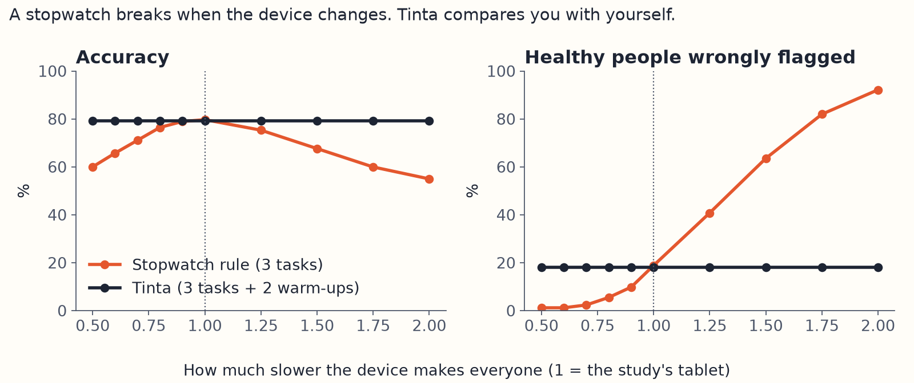

# Tinta

**A 2-minute handwriting check on the phone you already own. It measures how you write, not what you write.**

**Track:** AI + Health · **Starting point:** our own idea

> This project is a prototype and is not medical advice.

<!-- TODO before submitting: live demo link, video link, screenshot or GIF -->

## The problem

Lucía is 45. Her mother Carmen, 72, repeats questions and left the stove on last week. Is it normal forgetfulness, or should they see a doctor? Screening tests happen in a clinic, weeks away. People with early Alzheimer's hesitate more while writing: the pen spends longer in the air between strokes. Paper hides that. A touchscreen can time it.

## What we built

A web app that runs on any phone, also packaged as an Android app that works offline. Carmen does five short tasks with her finger: two warm-ups (joining two dots), then tracing a circle, writing "le" four times, and writing a phone number she hears. After each task Tinta shows her "invisible ink": where the finger left the screen and how long it paused. At the end she gets one of three answers: **within the usual pattern**, **worth mentioning to a doctor**, or **I can't tell**. The model runs in the browser. Nothing leaves the phone.

## What we added

Everything below is ours; we did not start from a suggested project.

- **From 25 tasks to 5.** The original study needs 25 tasks on a professional tablet. We searched for the few that carry the signal.
- **A model that survives a change of device.** Instead of timing people against a clock, Tinta times each task against the person's own warm-up pace.
- **A test of that claim**, and of when it fails.

## How it works

**Data.** [DARWIN](https://doi.org/10.24432/C55D0K): 174 people (89 with Alzheimer's, 85 healthy) who each did 25 handwriting tasks, with 18 measures per task. We use only four that a phone can also take: time in the air, time on the surface, total time, and number of pen-downs. No cleaning was needed (no missing values).

**Model.** Logistic regression on nine numbers: for each of three scored tasks, (1) how much slower it was than the person's own warm-ups, (2) the share of time spent in the air, (3) the number of touches. The three tasks were chosen by forward selection using training people only. We picked a small linear model on purpose: with 174 people, bigger models did not do better (see `ml/results/3_model_search.txt`).

## Results

All numbers are on people the model did not see (5-fold cross-validation repeated 3 times; tasks re-chosen inside every fold).

| | Same device as the study | Device 1.5× slower | Device 2× slower |
|---|---|---|---|
| **Baseline: stopwatch rule**, 3 tasks | 80% accurate | 68% (64% false alarms) | 55% (92% false alarms) |
| **Tinta**, 3 tasks + 2 warm-ups | 79% accurate | 79% (18% false alarms) | 79% (18% false alarms) |



On the study's own tablet, **our model does not beat a stopwatch**. With only a few tasks, nothing we tried did. A trained model only pulls ahead with all 25 tasks (91% against 81%). What Tinta adds is that it keeps working when the device changes, and a stopwatch does not.

On a fixed held-out set of 35 people, Tinta missed 4 of 18 patients and raised 4 false alarms among 17 healthy people.

**Where it fails, and why.**

- *Patients who are slow at everything.* Tinta compares you with your own pace, so someone who is slow on the warm-ups too looks consistent. This is the cost of not depending on the device. The app shows real cases like this ("Show a mistake").
- *Healthy people who hesitate.* A distraction looks the same as a cognitive pause.
- *The device change is simulated* as "everything uniformly slower". A finger may change some tasks more than others.
- *No age or sex in the public data*, so we cannot check that it works equally well across groups. The paper says the two groups were matched on age, education and gender.
- *Never tested with patients on a phone.* The study used a pen on paper over a tablet, in Italian.

## What we'd do next

1. Record healthy volunteers and, with a patients' association, people with a diagnosis, on real phones, to replace the simulated device change with a measured one.
2. Follow the same person over months: Carmen compared with Carmen, not with a study group.

## Run it

```
cd web && npm install && npm run dev        # the app
python -m venv .venv && .venv/Scripts/python -m pip install -r requirements.txt
cd ml && ../.venv/Scripts/python device_shift.py   # any experiment; saved outputs are in ml/results/
../.venv/Scripts/python figures.py                 # redraw the charts in docs/

# Android app (the same web app bundled in a WebView, with a native voice for the dictation)
cd web && npm run build && cd ../android && ./gradlew assembleDebug
node android/tools/emulator-check.mjs shot.png      # end-to-end check with real touch events on an emulator
```

## Sources

- **Dataset:** Fontanella, F. (2022). DARWIN. UCI Machine Learning Repository, CC BY 4.0. https://doi.org/10.24432/C55D0K · Cilia, De Gregorio, De Stefano, Fontanella, Marcelli, Parziale (2022), *Diagnosing Alzheimer's disease from on-line handwriting: a novel dataset and performance benchmarking*, Engineering Applications of Artificial Intelligence. Task list from https://arxiv.org/abs/2405.00755.
- **Libraries:** scikit-learn, pandas, NumPy (Python); React, Vite, TypeScript (web).
- **Fonts:** Fraunces and Atkinson Hyperlegible (SIL Open Font License), via Google Fonts.
- **AI tools:** Claude Code (Anthropic) was used to plan, write and debug code and to draft this text. Every experiment was run and checked by us, and we can explain each part.
- **Pretrained models:** none. The mascot is hand-written SVG.

MIT License.
